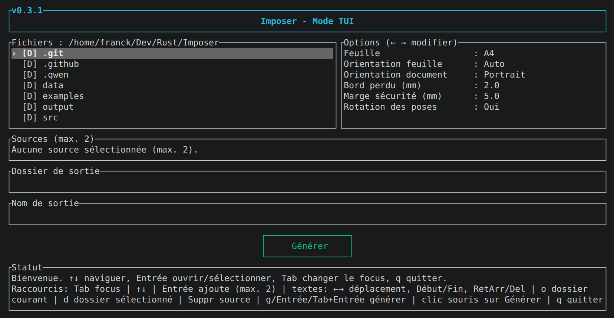
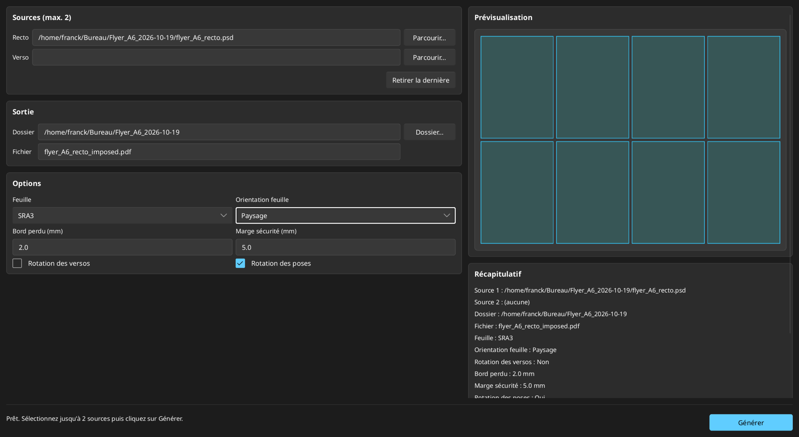

# Imposer

[](https://github.com/Franck-Demongin/Imposer/actions/workflows/ci.yml)
[](https://github.com/Franck-Demongin/Imposer/releases)
[](LICENSE)

Imposer est une application Rust pour imposer des pages PDF, PNG, JPEG/JPG et PSD
sur des planches A4, A3 et SRA3. Elle fournit un outil en ligne de commande,
une interface texte interactive et une interface graphique Slint optionnelle.

## Sommaire

- [Fonctionnalités](#fonctionnalités)
- [Binaires inclus](#binaires-inclus)
- [Installation](#installation)
- [Démarrage rapide](#démarrage-rapide)
- [Entrées et compatibilité](#entrées-et-compatibilité)
- [Processus d'imposition](#processus-dimposition)
- [Référence de ligne de commande](#référence-de-ligne-de-commande)
- [Interface texte (TUI)](#interface-texte-tui)
- [Interface graphique (Slint)](#interface-graphique-slint)
- [Formats de feuille et préréglages](#formats-de-feuille-et-préréglages)
- [Profils couleur et PDF/X-4](#profils-couleur-et-pdfx-4)
- [Sortie et repères de coupe](#sortie-et-repères-de-coupe)
- [Intégration Linux](#intégration-linux)
- [Intégration Windows](#intégration-windows)
- [Icônes et ressources](#icônes-et-ressources)
- [Développement](#développement)
- [CI et publications](#ci-et-publications)
- [Structure du dépôt](#structure-du-dépôt)
- [Contribuer](#contribuer)
- [Licence](#licence)

## Fonctionnalités

- Imposition la plus dense, avec rotation individuelle optionnelle des copies.
- Fond perdu et marge de sécurité non imprimable configurables.
- Repères de coupe calculés à partir des arêtes de découpe uniques.
- Conservation des ressources PDF et des profils CMJN compatibles lors de
  l'émission.
- Recto et verso à partir d'un PDF de une ou deux pages, ou de deux fichiers.
- Entrées RVB, PNG, JPEG et PSD, avec décodage Rust natif pour les PSD.
- Classification ICC entre RVB et CMJN pour les sources PDF et PSD.
- Affichage du profil couleur détecté pendant la génération.
- Pas de dépendance directe à ImageMagick à l'exécution.
- Ghostscript est nécessaire à l'exécution pour les sources RVB (PNG, JPEG/JPG)
  et le repli PDF/X ; les sources CMJN compatibles sont émises en natif.
- TUI et GUI Slint optionnelle avec thème système et génération en arrière-plan.

## Binaires inclus

| Binaire | Contenu | Compilation |
| --- | --- | --- |
| `imposer` | CLI et TUI | `cargo build --release` |
| `imposer-gui` | Interface graphique Slint | `cargo build --release --features gui` |

La feature `gui` est un alias de `slint-ui`. Une commande limitée à
`--features gui --bin imposer-gui` évite de compiler le binaire CLI. Les
artefacts de publication sont `imposer.exe`, `imposer-gui.exe`, `imposer` et
`imposer-gui`.

## Installation

Rust 1.85 est la borne basse déclarée par `rust-version` dans `Cargo.toml`
pour l'édition 2024. Les dépendances, notamment Slint, peuvent exiger une
version plus récente; sinon, utilisez la dernière version stable.

### Dépendances d'exécution

Ghostscript est requis à l'exécution pour générer des sources RVB (PNG, JPEG/JPG)
et tous les replis. Les sources CMJN compatibles sont émises en natif.

- Linux : `sudo apt-get install -y ghostscript` (commande `gs`)
- macOS : utilisez la commande `gs` (par exemple après `brew install ghostscript`)
- Windows : installez Ghostscript et placez `gswin64c.exe` dans `PATH`

### Dépendances de compilation Linux (GUI)

Pour compiler la GUI sous Linux, y compris via `cargo install --locked --features gui` :

```sh
sudo apt-get install -y \
  libfontconfig1-dev \
  libfreetype6-dev \
  libx11-dev \
  libxkbcommon-dev \
  libwayland-dev
```

### Prérequis Windows

Ghostscript doit être installé pour générer des sources RVB ; `gswin64c.exe` doit être disponible dans `PATH`. Les sources CMJN compatibles sont émises en natif, sans Ghostscript.

### Télécharger une version

Récupérez l'exécutable correspondant au système depuis la page Release de GitHub :
sous Windows, `imposer.exe` et `imposer-gui.exe`; sous Linux, `imposer` et
`imposer-gui`.

Les binaires Linux téléchargés peuvent utiliser l'intégration bureau livrée avec
le dépôt, depuis un clone du dépôt :

```sh
chmod +x imposer-gui
./packaging/linux/install-local.sh "$HOME/Downloads/imposer-gui"
```

Les binaires Linux sont compilés sur une version récente d'Ubuntu ; une distribution plus ancienne peut être incompatible avec leur version de `glibc`.

Exécution directe :

```sh
# Linux
./imposer
```

```powershell
# Windows PowerShell
.\imposer.exe
```

### Installer avec Cargo

```sh
cargo install --locked --git https://github.com/Franck-Demongin/Imposer.git --branch master --features gui
```

Cette commande installe le dernier état de la branche `master`. Pour une version
précise, ajoutez `--tag vX.Y.Z`.

Les commandes sont installées dans `$HOME/.cargo/bin`. Si ce répertoire n'est
pas dans `PATH`, ajoutez-le dans votre profil ou la session active, puis relancez
la détection des commandes :

```sh
export PATH="$HOME/.cargo/bin:$PATH"
```

### Compiler depuis les sources

```sh
git clone https://github.com/Franck-Demongin/Imposer.git
cd Imposer
cargo build --release
cargo build --release --features gui
```

La première commande compile `imposer`; la seconde active l'interface graphique
optionnelle et compile les deux binaires. Pour compiler uniquement la GUI :

```sh
cargo build --release --features gui --bin imposer-gui
```

### Lancer les interfaces

```sh
target/release/imposer
target/release/imposer-gui
```

Sous Windows :

```powershell
.\target\release\imposer.exe
.\target\release\imposer-gui.exe
```

## Démarrage rapide

Lancer la TUI sans argument ou sans chemin de sortie :

```sh
imposer --tui
```

Générer une planche depuis la ligne de commande :

```sh
imposer \
  --input document.pdf \
  --output planche.pdf \
  --sheet sra3 \
  --bleed 3 \
  --safety-margin 5
```

## Entrées et compatibilité

| Source | Type couleur | Résolution | Notes |
| --- | --- | --- | --- |
| PDF | RVB ou CMJN | Boîte de page source | Une ou deux pages, ressources préservées |
| PNG ou JPEG | RVB | 300 DPI par défaut, lue si présente | Profil ICC ignoré, sortie DeviceRGB |
| PSD | RVB, niveau de gris ou CMJN | Résolution intégrée, 300 DPI par défaut | Décodage Rust natif, ICC obligatoire en CMJN |

Toutes les sources d'une même planche doivent respecter :

- une différence de dimensions inférieure à `0,5 pt`;
- un même type couleur, soit toutes RVB, soit toutes CMJN;
- un profil CMJN compatible, comparé par SHA-256;
- un fond perdu ne dépassant pas la moitié de l'une des dimensions source.

Les dimensions d'entrée incluent déjà le fond perdu. La taille de découpe
dérivée est `dimensions source - 2 × fond perdu`.

## Processus d'imposition

1. Calcul des dispositions candidates.
2. Sélection de la disposition la plus dense, puis de la perte minimale.
3. Rotation individuelle des copies pour améliorer le placement, sauf option
   désactivée.
4. Placement centré.
5. Dérivation des repères de coupe depuis les arêtes de découpe uniques.
6. Génération du PDF, avec préservation des ressources et métadonnées couleur.

Le recto et le verso partagent la même grille de placement. Avec
`--rotate-verso`, le verso subit une rotation de 180°; sans cette option, il
conserve le même repère de feuille.

## Référence de ligne de commande

```sh
imposer \
  --input recto.pdf \
  --input verso.pdf \
  --output planche.pdf \
  --sheet sra3 \
  --bleed 3 \
  --safety-margin 5
```

| Option | Défaut | Description |
| --- | --- | --- |
| `-i, --input` | absent | Source, option répétable |
| `-o, --output` | absent | PDF généré |
| `--sheet` | `a4` | `a4`, `a3` ou `sra3` (formats intégrés ; dimensions personnalisées avec `--sheet-width-mm` et `--sheet-height-mm`) |
| `--sheet-width-mm` | absent | Largeur de feuille personnalisée, en millimètres |
| `--sheet-height-mm` | absent | Hauteur de feuille personnalisée, en millimètres |
| `--sheet-orientation` | `auto` | `auto`, `portrait` ou `landscape` |
| `--bleed` | `2.0` | Fond perdu en millimètres |
| `--safety-margin` | `5.0` | Marge de sécurité en millimètres |
| `--rotate-verso` | `false` | Force une rotation de 180° du verso |
| `--no-rotate-copies` | `false` | Désactive la rotation optimisante des copies |
| `--tui` | `false` | Lance l'interface texte |

Les dimensions personnalisées doivent être fournies ensemble. Si l'entrée ou la
sortie manque, `imposer` lance la TUI.

## Interface texte (TUI)



```sh
imposer --tui
```

La TUI se lance automatiquement sans argument ou sans chemin de sortie. Elle
permet de naviguer dans les formats `pdf`, `png`, `jpg`, `jpeg` et `psd` et
d'ajouter jusqu'à deux sources. Un PDF de deux pages fournit les deux pages;
lorsque plusieurs sources sont sélectionnées, seule la première page de chaque
fichier est conservée. La touche `Suppr` retire la dernière source.

Elle prend également en charge :

- les formats A4, A3 et SRA3;
- les dimensions de feuille selon l'utilisateur, avec validation;
- les préréglages personnels persistants;
- les contrôles, le niveau de statut et un indicateur d'activité pendant la
  génération;
- l'ouverture du fichier ou du dossier généré lorsqu'il est disponible.

Les préréglages personnels sont stockés dans un fichier TOML :

- Linux : `${XDG_CONFIG_HOME:-$HOME/.config}/imposer/presets.toml`
- macOS : `$HOME/Library/Application Support/imposer/presets.toml`
- Windows : `%APPDATA%\imposer\presets.toml`

Les noms de préréglage doivent être uniques. Les noms vides ou trop longs sont
refusés.

## Interface graphique (Slint)



```sh
cargo build --release --features gui
target/release/imposer-gui
```

Sous Windows, le fichier construit est `target/release/imposer-gui.exe`. Cette
interface graphique :

- suit la palette système;
- propose les mêmes options de feuille, de fond perdu, de marge et de verso;
- garde l'interface réactive pendant la génération;
- affiche les informations couleur, d'avancement et de chemin;
- ouvre le fichier généré ou son dossier.

Aucune action supplémentaire n'est nécessaire après compilation. L'icône
d'application est incorporée lors de la compilation.

## Formats de feuille et préréglages

Exemple avec une feuille personnalisée :

```sh
imposer \
  --input document.pdf \
  --output planche.pdf \
  --sheet-width-mm 320 \
  --sheet-height-mm 450
```

Les formats intégrés sont verrouillés sur A4, A3 et SRA3. Les dimensions
personnalisées exigent une largeur et une hauteur, exprimées en millimètres.

Les nouveaux préréglages sont validés avant d'être écrits, évitant qu'un fichier
TOML devienne inutilisable à cause de valeurs incorrectes.

## Profils couleur et PDF/X-4

- Les sources RVB sont écrites en DeviceRGB.
- Les sources CMJN conservent leur profil ICC.
- Les sources PDF et PSD CMJN sont inspectées récursivement pour les intentions
  de sortie et les profils ICC.
- Les sources CMJN sont comparées par SHA-256 et doivent être compatibles.
- Les métadonnées PDF/X-4 sont émises lorsque toutes les sources sont CMJN avec
  un profil compatible.
- La génération est native pour le CMJN compatible et utilise Ghostscript comme
  repli pour RVB, les profils incompatibles et les cas non supportés.
- Ghostscript est requis pour les sources RVB, y compris PNG, JPEG/JPG ; sans
  lui, ces générations échouent avec `Ghostscript introuvable`. Les sources
  CMJN compatibles sont émises en natif sans Ghostscript.
- Aucune conversion implicite n'existe entre RVB et CMJN.

La ligne de commande affiche le profil couleur détecté pour chaque source avant
génération.

## Sortie et repères de coupe

- La ligne de commande indique le chemin généré et la taille du fichier.
- Toutes les sources font l'objet d'un rapport couleur.
- Les repères utilisent les arêtes de coupe uniques, avec tolérance `0,01 mm`.
- Les marques font `2 mm`, sont placées à au moins la distance du fond perdu de
  la découpe, ont `0,25 pt` et sont de couleur register.
- Les repères sont dessinés uniquement dans la marge extérieure de la feuille.
- Une marge de feuille insuffisante provoque une erreur.

## Intégration Linux

L'identifiant XDG est :

```text
io.github.Franck-Demongin.Imposer
```

Compilation et installation locale :

```sh
cargo build --release --features gui --bin imposer-gui
./packaging/linux/install-local.sh target/release/imposer-gui
```

Le script vérifie l'exécutable, l'installe dans `~/.local/bin`, enregistre l'entrée
de bureau et les icônes hicolor, et rafraîchit les caches disponibles.
Désinstallation :

```sh
./packaging/linux/uninstall-local.sh
```

Les champs `Icon=` et `StartupWMClass=` doivent rester identiques à l'identifiant
d'application. L'interface Slint appelle `slint::set_xdg_app_id` après la
création de la fenêtre, ce qui est requis sous GNOME/Wayland. GNOME/Wayland peut
nécessiter une nouvelle session avant d'afficher le lanceur fraîchement installé.

## Intégration Windows

- L'icône est intégrée avec `winresource` pendant la compilation.
- La génération de sources RVB requiert Ghostscript (`gswin64c.exe`) dans PATH ;
  les sources CMJN compatibles sont émises en natif.
- Le paramètre `windows_subsystem = "windows"` évite l'ouverture d'une console.

## Icônes et ressources

Les icônes sont générées depuis `assets/icons/imposer.svg` :

```sh
./assets/icons/generate.sh
```

Les PNG et ICO générés sont gardés dans le dépôt afin que le build habituel ne
dépende pas de `rsvg-convert` ni d'ImageMagick. Régénérez ces ressources après
modification du SVG source.

## Développement

Validation locale :

```sh
cargo fmt --check
cargo test --locked
cargo clippy --all-targets --all-features --locked -- -D warnings
cargo build --locked
cargo build --locked --features gui
```

La CI utilise les mêmes commandes. Pour valider l'entrée de bureau sous Linux,
`desktop-file-utils` reste nécessaire :

```sh
sudo apt-get install -y desktop-file-utils
desktop-file-validate packaging/linux/io.github.Franck-Demongin.Imposer.desktop
```

## CI et publications

La CI compile sur Ubuntu et Windows, exécute les tests, valide l'entrée bureau et
utilise les builds verrouillés. La publication est déclenchée par un tag `v*` :

1. Le job Windows construit les binaires, génère les notes depuis le tag
   précédent, puis publie `imposer.exe` et `imposer-gui.exe`.
2. Le job Linux dépend du précédent, puis ajoute `imposer` et `imposer-gui`.

Les builds natifs ciblent `windows-latest` et `ubuntu-latest`. Les artefacts sont
tous attachés à la même release. La CI vérifie aussi les fichiers requis, l'APP_ID
et la cohérence du fichier `.desktop` vis-à-vis de `io.github.Franck-Demongin.Imposer`.

## Structure du dépôt

```text
Cargo.toml                  Manifeste et dépendances
Cargo.lock                  Verrou exact des dépendances
LICENSE                     Licence MIT
QWEN.md                     Contexte interne pour l'assistant de code
src/main.rs                 Point d'entrée CLI/TUI
src/gui_main.rs             Point d'entrée GUI Slint
src/lib.rs                  Bibliothèque partagée et API publique
src/tui.rs                  Interface texte
src/slint_ui.rs             Interface graphique Slint
ui/main.slint               Interface Slint et jetons de style
src/generation.rs           Orchestration partagée
src/layout.rs               Calcul de la mise en page
src/config.rs               Options d'imposition
src/pdf.rs                  Génération PDF et repères
src/source.rs               Formats d'entrée et dimensions
src/icc.rs                  Gestion des profils ICC
build.rs                    Compilation Slint et icône Windows
packaging/linux/            Intégration bureau Linux
assets/icons/               Icônes et script de génération
examples/                    Exemples et générateur de données
.github/workflows/         CI et publication
tests/                      Tests unitaires et d'intégration
```

## Contribuer

Exécutez les commandes de validation locale avant soumission. Les messages de
commit sont en anglais et respectent le format Conventional Commits. Pour les
changements d'interface, conservez le thème système et laissez l'identifiant
application correspondre à `io.github.Franck-Demongin.Imposer`.

Pour les changements concernant les couleurs ou les formats de feuille, décrivez
la couverture de tests de non-régression attendue dans la pull request.

Règle `APP_ID` : conservez l'emplacement de `APP_ID` dans `src/slint_ui.rs` et
l'ordre des appels `AppWindow::new()` puis `slint::set_xdg_app_id(...)`.
Sans ce réglage, l'icône n'est plus appliquée correctement sous GNOME/Wayland.

## Licence

MIT, voir le fichier `LICENSE`. Les dépendances Rust et Slint conservent leurs licences propres.
